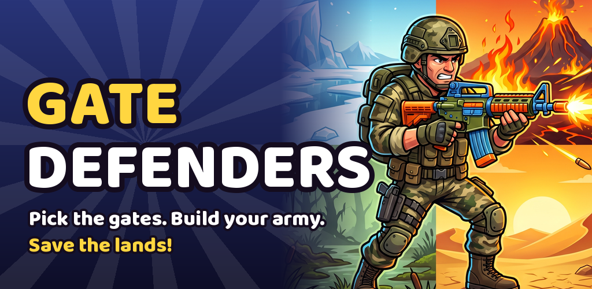
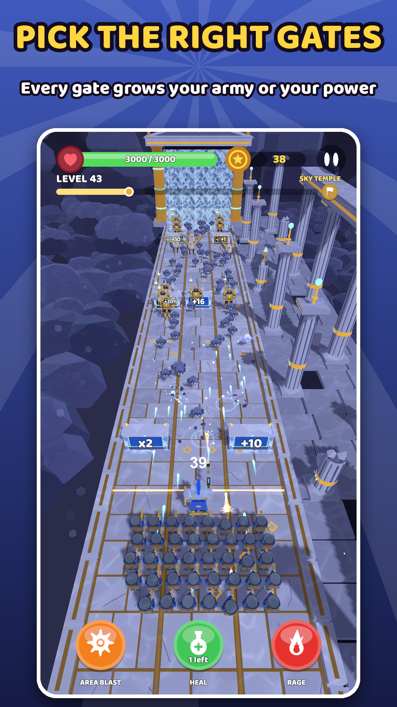
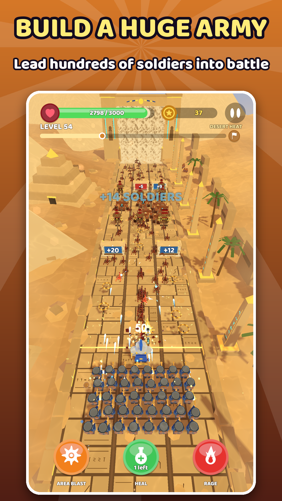
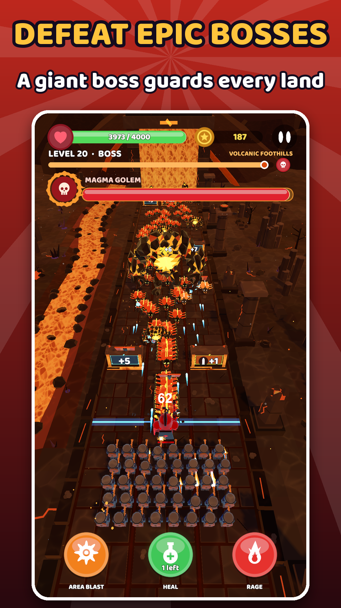
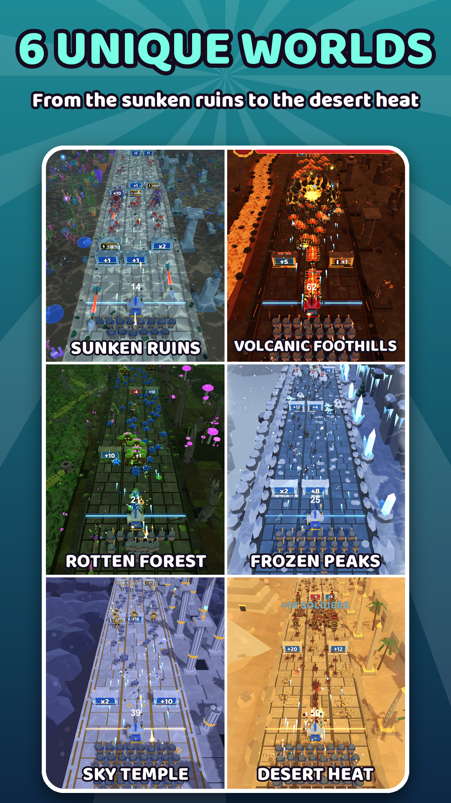
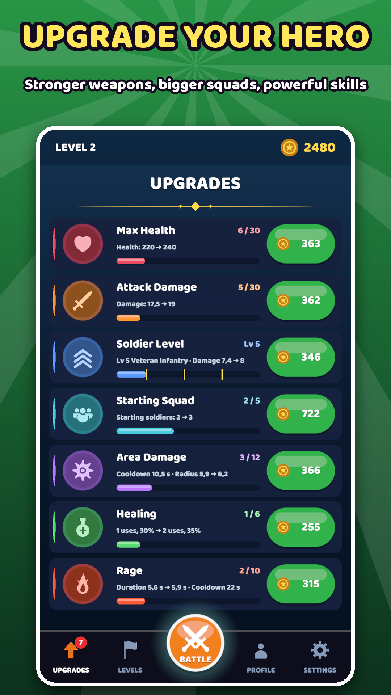
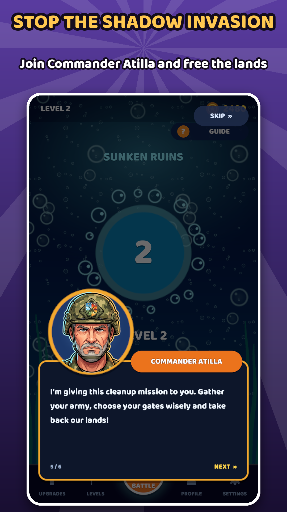

# Gate Defenders 🛡️



Unity ile geliştirilmiş, Android için mobil bir aksiyon / strateji oyunu. Oyuncu ordusunu kapılardan geçirerek büyütür, düşman dalgalarına ve dünya sonu boss'larına karşı savaşır.

## Özellikler

- **6 farklı dünya:** Su Altı, Yanardağ, Bataklık, Kar, Gökyüzü ve Çöl
- Her dünyaya özel düşmanlar ve **boss savaşları** (Yengeç Boss, Magma Golem, Akrep Firavun, Fırtına Lordu…)
- Orduyu büyüten / küçülten **kapı sistemi**
- **Yetenekler ve geliştirmeler** (upgrade sistemi)
- **Günlük görevler**, hikâye anlatımı ve kayıt sistemi
- Türkçe / İngilizce dil desteği
- Mobil performans ayarları, titreşim (haptics) ve tam ekran modu

## Ekran Görüntüleri

| | | |
|---|---|---|
|  |  |  |
|  |  |  |

## Teknik Bilgiler

- **Motor:** Unity 6 (6000.5.1f1), Universal Render Pipeline (URP)
- **Dil:** C#
- **Platform:** Android

## Proje Yapısı

```
Assets/_Game/
├── Scripts/     # Oyun kodları (Combat, Core, Data, Gates, Level, Skills, UI, Audio, Art)
├── Prefabs/     # Düşman ve boss prefabları
├── Data/        # Dünya ve geliştirme ayarları (ScriptableObject)
├── Scenes/      # Loading, MainMenu, Game sahneleri
├── Shaders/     # Özel shader'lar (toon, su, efektler)
└── Art/         # Modeller, dokular, materyaller
```

## Kurulum

1. Depoyu klonlayın: `git clone https://github.com/ibrahim688-ker/GateDefenders.git`
2. Unity Hub'dan **Unity 6000.5.1f1** (veya uyumlu Unity 6 sürümü) ile projeyi açın.
3. `Assets/_Game/Scenes/Loading.unity` sahnesini açıp **Play**'e basın.
